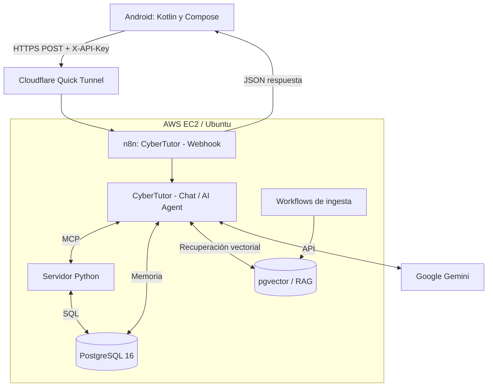

# CyberTutor

> Asistente académico inteligente para el curso de Ciberseguridad (18017) de Ingeniería de Sistemas, UNAB.

**Estado:** prototipo universitario funcional, con despliegue de demostración en AWS Academy. **Autores:** Abi (automatización, datos e integración del agente) y Johan (Android, despliegue y conectividad). **Corte documental:** 24 de noviembre de 2026.

## Índice

- [Objetivos y alcance](#objetivos-y-alcance)
- [Arquitectura](#arquitectura)
- [Infraestructura](#infraestructura)
- [Base de datos](#base-de-datos)
- [RAG](#rag)
- [Workflows](#workflows)
- [MCP](#mcp)
- [API HTTP](#api-http)
- [Android](#android)
- [Configuración](#configuración)
- [Instalación y despliegue](#instalación-y-despliegue)
- [Operación y recuperación](#operación-y-recuperación)
- [Pruebas](#pruebas)
- [Seguridad](#seguridad)
- [Estado y pendientes](#estado-y-pendientes)

## Objetivos y alcance

CyberTutor integra un agente basado en Gemini con información académica estructurada y material del curso. Permite consultar matrícula, progreso, proyección de notas, recomendaciones y dudas conceptuales mediante lenguaje natural. No entrena un modelo propio ni sustituye al docente o al sistema académico institucional. Los datos utilizados en la demostración son de prueba.

## Arquitectura



El diagrama representa el flujo lógico; pgvector forma parte de PostgreSQL, no es otro servidor. Gemini es un servicio externo. La respuesta retorna por el mismo canal HTTP. El detalle de invocación entre workflows debe contrastarse con sus exportaciones actuales.

## Infraestructura

| Componente | Tecnología / configuración observada | Responsabilidad |
|---|---|---|
| Máquina virtual | AWS EC2, Ubuntu, región us-east-1 | Ejecutar el backend |
| Administración | Docker Compose | Crear y administrar servicios |
| `cybertutor-db` | `pgvector/pgvector:pg16` | Datos, memoria y vectores |
| `cybertutor-mcp` | Imagen construida desde `./mcp-server`; `python server.py` | Herramientas académicas |
| `cybertutor-n8n` | `docker.n8n.io/n8nio/n8n:latest` | Automatización y webhook |
| Cloudflare | `cloudflared tunnel --url http://127.0.0.1:5678` | Entrada HTTPS temporal |
| Cliente | APK Android | Interfaz y solicitudes |

### Puertos y red

| Puerto | Servicio | Publicación observada | Recomendación |
|---|---|---|---|
| 5432/TCP | PostgreSQL | 0.0.0.0 y IPv6 | Restringir a red interna Docker |
| 9000/TCP | MCP | 0.0.0.0 y IPv6 | Restringir a red interna Docker |
| 5678/TCP | n8n | 0.0.0.0 y IPv6 | Limitar a localhost o acceso administrativo autorizado |
| 443/TCP | HTTPS público de Cloudflare | Servicio externo | Mantener TLS |
| 22/TCP | SSH (si se habilita) | Según Security Group | Solo acceso autorizado |

La publicación de un puerto no demuestra que sea accesible desde Internet: depende del Security Group, firewall y rutas. El túnel conecta hacia n8n en localhost. No se requiere exponer PostgreSQL o MCP a Internet para que Android funcione.

### Propiedades de Compose conocidas

- `image`: imagen base del servicio; `build`: contexto de construcción del MCP.
- `container_name`: nombres de contenedores de la tabla anterior.
- `ports`: mapeo host:contenedor.
- `environment`: parámetros de conexión y secretos inyectados al proceso.
- `restart: unless-stopped`: reinicio automático salvo detención explícita; requiere que Docker y EC2 estén activos.
- `depends_on`: MCP depende de PostgreSQL saludable, según configuración histórica.
- `healthcheck`: PostgreSQL aparece como `healthy`; comando exacto e intervalos pendientes de revisar.
- `volumes`: persistencia requerida para PostgreSQL, n8n y documentos; nombres y montajes exactos pendientes de inspección.

## Base de datos

PostgreSQL almacena registros relacionales y vectores. El historial del proyecto reporta 16 tablas en una etapa del desarrollo; el inventario parcial conocido es el siguiente. No se inventan columnas, claves ni restricciones que no estén disponibles en los scripts.

| Tabla | Finalidad |
|---|---|
| `curso` | Información de la asignatura |
| `unidades` | Unidades temáticas |
| `semanas` | Planeación semanal |
| `actividades` | Actividades académicas |
| `practicas` | Prácticas del curso |
| `estudiantes` | Identificación de estudiantes |
| `inscripciones` | Matrículas |
| `notas` | Calificaciones |
| `asistencia` | Registros de asistencia |
| `progreso_practicas` | Seguimiento de prácticas |
| `noticias` | Noticias para integración informativa |
| `config` | Parámetros académicos |
| `documentos_rag` | Vectores de configuración 1000/150 |
| `documentos_rag_500` | Vectores de configuración 500/100 |
| Tablas de memoria | Contexto conversacional; nombre exacto por verificar |

Scripts históricos: `02_schema.sql`, `03_seed_curso.sql`, `04_seed_estudiantes.sql` en `init/`. Los scripts de inicialización de la imagen PostgreSQL suelen ejecutarse únicamente cuando el directorio de datos está vacío; no eliminar volúmenes para forzar su ejecución.

### Inspección del esquema real

```bash
docker exec -it cybertutor-db psql -U cyber_admin -d cybertutor -c '\dt'
docker exec -it cybertutor-db psql -U cyber_admin -d cybertutor -c '\d+ inscripciones'
docker exec -it cybertutor-db psql -U cyber_admin -d cybertutor -c '\dx'
```

```sql
SELECT table_name, column_name, data_type, is_nullable, column_default
FROM information_schema.columns
WHERE table_schema = 'public'
ORDER BY table_name, ordinal_position;
```

## RAG

Retrieval-Augmented Generation (RAG) recupera fragmentos relevantes antes de generar una respuesta. No equivale a reentrenar Gemini.

### Ingesta

1. Leer archivos Markdown desde `rag-docs/` (ruta histórica dentro de n8n: `/home/node/.n8n-files/rag-docs/`).
2. Dividir el contenido en fragmentos con solapamiento.
3. Generar embeddings con Google Gemini.
4. Almacenar vectores y metadatos en PostgreSQL/pgvector.
5. Recuperar fragmentos mediante `buscar_material_curso` al consultar el agente.

| Tabla | Chunk (caracteres, según historial) | Overlap | Fragmentos históricos |
|---|---:|---:|---:|
| `documentos_rag` | 1000 | 150 | 56 |
| `documentos_rag_500` | 500 | 100 | 131 |

Se trabajó con siete documentos, incluyendo material del curso y `07_unidad5_sgsi_cumplimiento.md`. La ingesta 500/100 de este último falló con `vector must have at least 1 dimension`; se resolvió dividiéndolo en dos mitades (9 + 8 fragmentos) y unificando el metadato `fuente`. La causa exacta del embedding vacío no quedó demostrada.

El chunk pequeño puede mejorar la precisión temática; el grande conserva más contexto. No se ha acreditado una comparación cuantitativa completa. El modelo exacto de embeddings y la tabla seleccionada actualmente deben verificarse en n8n. Usar el mismo modelo y dimensión para ingesta y consulta.

```sql
SELECT metadata->>'fuente' AS fuente, count(*)
FROM documentos_rag_500 GROUP BY 1 ORDER BY 1;
```

Evitar duplicar fragmentos al reingestar; realizar respaldo y controlar la eliminación por fuente antes de repetir una ingesta. Los workflows de ingesta no necesitan ejecutarse con cada pregunta.

## Workflows

| Workflow | Función | Estado documentado |
|---|---|---|
| CyberTutor - Webhook | Entrada POST autenticada y respuesta JSON | Activo durante pruebas |
| CyberTutor - Chat | Agente conversacional y herramientas | Invocado desde el sistema; no requiere publicación independiente si es subflujo |
| Ingesta RAG | Preparación de documentos 1000/150 | Ingesta histórica completada |
| Ingesta RAG (500-100) | Comparación de fragmentación | Ingesta histórica completada |
| CyberTutor Scraper | Procesamiento de información web/noticias | Mencionado en explicación posterior; nodos, fuentes, programación y prueba final no verificados |

### Nodos conocidos del Chat

| Nodo / propiedad | Función |
|---|---|
| Chat Trigger | Entrada de conversación en n8n |
| AI Agent | Interpreta intención y decide herramientas |
| Google Gemini Chat Model | Modelo generativo; versión exacta por verificar |
| Postgres Chat Memory | Conserva contexto; clave de sesión y ventana por verificar |
| Postgres PGVector Store | Recuperación como herramienta del agente |
| `buscar_material_curso` | Nombre de herramienta RAG |
| Retrieve Documents (As Tool for AI Agent) | Modo histórico del vector store |
| Limit = 4 | Límite histórico de fragmentos recuperados |
| Include Metadata | Activado históricamente para identificar fuentes |
| Embeddings Google Gemini | Vectorización de consultas |
| MCP | Acceso a herramientas externas; configuración exacta por verificar |

### Reglas del agente

El prompt v2 histórico indica responder en español, consultar material antes de responder sobre el curso, mencionar la fuente, no inventar notas o fechas, orientar sin resolver entregas calificables, limitar prácticas de seguridad a entornos autorizados, rechazar ataques no autorizados y no revelar secretos o datos ajenos. Estas instrucciones son guardrails de comportamiento, no sustituyen controles de autorización en código.

## MCP

Model Context Protocol conecta el agente con herramientas externas. El servidor Python se ejecuta en el contenedor `cybertutor-mcp` y utiliza parámetros de PostgreSQL y `MCP_TOKEN`.

| Capacidad académica | Estado |
|---|---|
| Recuperar matrícula | Resultado observado de extremo a extremo |
| Consultar notas y progreso | Acceso rápido disponible en Android; contrato interno por verificar |
| Proyectar calificaciones | Acceso rápido disponible; fórmula, pesos y casos límite por verificar |
| Recomendar estudio | Acceso rápido disponible; lógica interna por verificar |

Los nombres `consultar_matricula`, `consultar_notas` y `proyectar_semestre` aparecen como propuestas históricas, no como firmas verificadas. Para documentar cada función real se requiere `mcp-server/server.py`, dependencias y exportaciones n8n. No se debe asumir el transporte MCP, ruta, parámetros, tipos de retorno o consultas SQL exactas.

## API HTTP

### POST `/webhook/cybertutor/chat`

| Propiedad | Valor |
|---|---|
| Método | POST |
| Content-Type | application/json; charset=utf-8 |
| Autenticación | Header `X-API-Key` |
| `codigo` | String; código de estudiante, ejemplo E0001 |
| `mensaje` | String; consulta en lenguaje natural |
| `respuesta` | String; respuesta esperada en JSON |

```json
{"codigo":"E0001","mensaje":"Muéstrame mis datos de matrícula en el curso."}
```

```json
{"respuesta":"Texto generado por el asistente."}
```

| Estado | Interpretación |
|---|---|
| 2xx | Android intenta interpretar JSON |
| 403 | Rechazo de autorización observado durante integración |
| 404 | Ruta/método no registrado; observado al usar GET |
| 5xx | Error del servidor o intermediario; revisar logs |
| Sin HTTP | Error DNS, conexión, TLS o timeout |

Los códigos exactos para validación de campos y errores internos dependen del workflow. No se ha verificado un contrato formal OpenAPI.

## Android

Código inspeccionado: versión rediseñada de `MainActivity.kt`, paquete `com.cybertutor.app`. Kotlin, Jetpack Compose, Material 3, corrutinas y `HttpURLConnection`.

### Funciones y clases

| Símbolo | Parámetros / retorno | Comportamiento |
|---|---|---|
| `MainActivity.onCreate` | `Bundle?` / Unit | Inicializa Activity, edge-to-edge, tema oscuro y pantalla |
| `consultarAgente` | `codigo: String, mensaje: String` / `String` (suspend) | POST en `Dispatchers.IO`, serializa JSON, autentica, lee respuesta UTF-8, maneja errores y desconecta en finally |
| `limpiar` | `t: String` / `String` | Quita negritas y encabezados Markdown, convierte viñetas y recorta espacios |
| `PantallaPrincipal` | `modifier: Modifier = Modifier` / Unit | Composable principal, estado, tarjetas, chat, entrada y carga |
| `enviar` | `mensaje: String` / Unit | Función local: valida, añade mensaje, limpia entrada, activa carga, consulta y añade respuesta |
| `Mensaje` | `id: Long, texto: String, usuario: Boolean` | Modelo de burbuja de conversación |
| `Acceso` | `titulo, descripcion, simbolo, consulta: String` | Modelo de acceso rápido |

### Estados y propiedades

| Estado | Inicial | Función |
|---|---|---|
| `codigo` | E0001 | Identificador editable; no equivale a autenticación |
| `pregunta` | cadena vacía | Entrada de texto |
| `cargando` | false | Bloquea nuevos envíos mientras hay solicitud |
| `siguienteId` | 1L | Identificador incremental de mensajes |
| `mensajes` | Saludo inicial, id 0 | Lista observable en memoria de Compose |
| `scope` | rememberCoroutineScope | Ejecuta consultas asíncronas |
| `lista` | rememberLazyListState | Control de desplazamiento |
| `LaunchedEffect(mensajes.size, cargando)` | reactivo | Desplaza al último mensaje o indicador |

El historial local usa `remember`, no almacenamiento persistente. Puede perderse al recrear la Activity. La memoria del agente es independiente. El indicador “En línea” es texto estático, no una comprobación de conectividad. Los errores se presentan como mensajes del asistente. No existe evidencia de login individual ni navegación inferior implementada.

### Accesos rápidos

| Título | Consulta enviada |
|---|---|
| Matrícula | Muéstrame mis datos de matrícula en el curso. |
| Mi progreso | ¿Cuál es mi estado académico actual? |
| Proyección | Haz la proyección: ¿qué nota necesito en lo que falta para aprobar? |
| Consejos | Dame recomendaciones concretas para estudiar esta semana. |

### Configuración de red y UI

- `connectTimeout = 15000` ms; `readTimeout = 120000` ms en la versión rediseñada.
- `doOutput = true`, método POST, UTF-8, `BuildConfig.WEBHOOK_URL`, `BuildConfig.API_KEY`.
- `optString("respuesta", ...)` en éxito; texto de error para otros códigos o excepciones.
- `Scaffold`, `LazyColumn`, tarjetas en dos columnas, campo inferior de hasta tres líneas, botón circular de 52 dp, envío mediante teclado.
- Colores: `Fondo #0B1220`, `Superficie #152238`, `Superficie2 #1A2A42`, `Borde #2B405A`, `Acento #65D9F4`, `Texto #F5F8FF`, `Secundario #A8BED5`.

## Configuración

### Backend `.env`

| Variable conocida | Uso |
|---|---|
| `POSTGRES_HOST` | Host de PostgreSQL accesible desde MCP |
| `POSTGRES_DB` | Base de datos |
| `POSTGRES_USER` | Usuario de base de datos |
| `POSTGRES_PASSWORD` | Contraseña |
| `MCP_TOKEN` | Autenticación del servidor MCP |

Los valores reales y otras variables de n8n no se incluyen. Conservar la clave de cifrado de credenciales de n8n y respaldar sus datos. Confirmar nombres adicionales en Compose y `.env.example`, si existe.

### Android `android/local.properties`

```properties
# Conservar sdk.dir generado por Android Studio
webhook.url=https://TU-HOST/webhook/cybertutor/chat
webhook.key=TU_CLAVE_DE_WEBHOOK
```

Gradle lee `webhook.url` y `webhook.key` y genera `BuildConfig.WEBHOOK_URL` y `BuildConfig.API_KEY`. La clave debe coincidir con Header Auth en n8n. No confundir con `MCP_TOKEN`. No publicar `.env`, `local.properties`, claves, dumps o exportaciones con credenciales.

### Estructura conocida (parcial)

```text
cybertutor/
├── android/
│   ├── app/build.gradle.kts
│   ├── app/src/main/java/com/cybertutor/app/MainActivity.kt
│   └── local.properties              # local, no versionar
├── mcp-server/                       # servidor Python
├── init/                             # SQL de inicialización
├── rag-docs/                         # material del curso
├── workflows/                        # exportaciones n8n
├── docs/                             # documentación y pruebas
├── .env                              # secretos, no versionar
└── README.md
```

El nombre exacto del archivo Compose y otros archivos deben verificarse en el repositorio.

## Instalación y despliegue

Requisitos: Git, Docker Engine con Compose, servidor Ubuntu autorizado, cloudflared, credenciales de Gemini y n8n; Android Studio/JDK compatible para compilar.

```bash
git clone https://github.com/Latorre655/cybertutor.git
cd cybertutor
# Configurar .env y credenciales antes de iniciar.
docker compose up -d --build
docker compose ps
```

En una instalación nueva, revisar los scripts SQL, importar workflows, configurar credenciales PostgreSQL, Gemini, MCP y Header Auth, ejecutar ingesta si no existe y publicar el webhook. No ejecutar ingesta repetidamente sobre datos existentes.

```bash
curl -fsS http://127.0.0.1:5678/healthz
cloudflared tunnel --url http://127.0.0.1:5678
```

Copiar el hostname generado a `webhook.url` con la ruta completa. El túnel temporal no garantiza disponibilidad ni conserva URL al recrearse.

### Compilar APK (Windows PowerShell)

```powershell
cd "C:\TRABAJOS UNI\CIENCIA DE DATOS\cybertutor\android"
$env:JAVA_HOME = "C:\Program Files\Android\Android Studio\jbr"
$env:Path = "$env:JAVA_HOME\bin;$env:Path"
.\gradlew.bat assembleDebug
explorer.exe .\app\build\outputs\apk\debug
```

Instalar `app-debug.apk` en un dispositivo autorizado. Para una distribución real, configurar firma release y autenticación adecuada.

## Operación y recuperación

```bash
cd ~/cybertutor
docker compose ps
docker compose up -d
curl -fsS http://127.0.0.1:5678/healthz
docker logs --tail 50 cybertutor-n8n
docker logs --tail 50 cybertutor-mcp
pgrep -af cloudflared
```

| Estado | Significado / acción |
|---|---|
| EC2 Running | Máquina disponible; comprobar servicios |
| EC2 Stopped | Encender desde consola autorizada |
| Up / Running | Proceso del contenedor activo; no prueba funcional completa |
| healthy | Healthcheck superado |
| unhealthy / Restarting | Revisar logs y dependencias |
| Registered tunnel connection | Conexión cloudflared establecida |
| PASS / hard_fail=false | Prechecks del túnel correctos; no prueba del webhook |
| Unable to resolve host | Revisar DNS y URL vigente |
| context canceled | Solicitud interrumpida; revisar cliente, tiempos y ejecuciones n8n |
| AWS 403 explicit deny | Revisar sesión y permisos del Learner Lab |
| Service Unavailable | Reintentar laboratorio y contactar soporte si persiste |

No recrear un túnel sano innecesariamente. Si cambia su URL, actualizar `local.properties`, compilar e instalar APK. AWS Academy puede detener instancias al finalizar el laboratorio; ningún reinicio automático dentro de Ubuntu evita esa restricción.

### Respaldo

```bash
mkdir -p backups
docker exec cybertutor-db pg_dump -U cyber_admin -d cybertutor -Fc -f /tmp/cybertutor_db.dump
docker cp cybertutor-db:/tmp/cybertutor_db.dump backups/cybertutor_db.dump
docker exec cybertutor-db pg_restore -l /tmp/cybertutor_db.dump
```

Respaldar también los datos persistentes de n8n, su clave de cifrado, exportaciones de workflows y documentos RAG. Para una copia consistente de datos locales de n8n, programar una ventana de mantenimiento o usar el mecanismo de respaldo de su base de datos. Probar restauración en un entorno aislado antes de restaurar producción. Nunca ejecutar `docker compose down -v` como solución rutinaria: elimina volúmenes asociados.

## Pruebas

### Solicitud desde PowerShell sin mostrar la clave

```powershell
$clave = (Get-Content .\local.properties | Where-Object { $_ -match '^webhook\.key=' }) -replace '^webhook\.key=', ''
$url = (Get-Content .\local.properties | Where-Object { $_ -match '^webhook\.url=' }) -replace '^webhook\.url=', ''
$body = @{ codigo = 'E0001'; mensaje = 'Hola, responde brevemente.' } | ConvertTo-Json
$tiempo = Measure-Command {
    $r = Invoke-RestMethod -Uri $url -Method POST -Headers @{ 'X-API-Key' = $clave } -ContentType 'application/json; charset=utf-8' -Body ([Text.Encoding]::UTF8.GetBytes($body)) -TimeoutSec 120
}
$tiempo.TotalSeconds
$r.respuesta
Remove-Variable clave
```

### Evidencia histórica

| Prueba | Resultado |
|---|---|
| Saludo HTTPS | 1,3655 s |
| Matrícula HTTPS | 17,2769 s; devolvió datos de E0001 |
| Compilación Android rediseñada | BUILD SUCCESSFUL en 20 s |
| APK en celular | Funcionamiento observado antes de interrupciones del túnel |
| Recuperación RAG | Llamada a `buscar_material_curso` observada en historial |

Las dos mediciones son muestras individuales, no promedios ni SLA. Revisar duración por nodo en n8n antes de atribuir latencia a Gemini, MCP o SQL.

### Matriz de pruebas recomendadas (pendientes de evidencia completa)

- Matrícula válida, código inexistente, código vacío y acceso a otro estudiante.
- Estado académico, proyección con notas faltantes y recomendaciones.
- Preguntas de semanas, porcentajes, reglas de IA e ISO 27001 con fuentes.
- Dato ausente: el agente debe admitir desconocimiento.
- Clave ausente o incorrecta, JSON inválido, método GET, timeout y pérdida de red.
- Intentos de revelar prompt, secretos, datos ajenos o resolver evaluaciones.
- Comparación RAG 1000/150 vs. 500/100 con las mismas consultas.
- Scraper: fuente, fecha, duplicados, contenido inválido y fallos de red.

## Seguridad

HTTPS cifra el tránsito al punto de entrada; no garantiza autorización académica. La clave compartida del webhook incluida en BuildConfig puede extraerse del APK. Un código editable como E0001 no autentica al estudiante. No usar datos reales hasta implementar identidad individual, autorización por registro, validación del servidor y pruebas de acceso cruzado.

Prioridades: restringir puertos y editor n8n; publicar solo la ruta necesaria mediante proxy; rotar secretos expuestos; usar roles de mínimo privilegio; parametrizar SQL; limitar tasa y tamaño de solicitudes; aislar sesiones de memoria; evitar datos sensibles en logs; fijar versiones de imágenes; actualizar dependencias y sistema operativo; respaldar y verificar restauraciones. Tratar contenido RAG y web como datos no confiables, no como instrucciones del agente. En scraper, limitar destinos autorizados y evitar acceso a redes internas.

## Estado y pendientes

| Componente | Estado |
|---|---|
| PostgreSQL, MCP, n8n | Contenedores activos en registros históricos |
| RAG | Dos ingestas históricas completadas |
| Gemini y memoria | Integración documentada; configuración vigente por verificar |
| Webhook y Android | Integración probada con matrícula |
| UI | Rediseño oscuro compilado |
| Scraper | Implementación exacta y pruebas pendientes de confirmar |
| URL estable | Pendiente; Quick Tunnel cambia de dirección |
| Rendimiento | Pendiente de perfilado |
| Seguridad de producción | Pendiente |
| Disponibilidad 24/7 | No garantizada por AWS Academy ni Quick Tunnel |

### Hoja de ruta

1. Exportar y versionar workflows sin secretos; inventariar funciones MCP y esquema SQL.
2. Configurar dirección HTTPS estable (túnel administrado con dominio o DNS dinámico y proxy TLS, según permisos del laboratorio).
3. Implementar autenticación individual y autorización de datos.
4. Medir latencias por nodo y optimizar recuperación y herramientas.
5. Automatizar respaldos, pruebas y monitoreo; documentar restauración.
6. Mejorar persistencia de chat, estado real de conectividad y manejo de errores Android.

## Referencias y alcance documental

Repositorio: https://github.com/Latorre655/cybertutor

Documentación oficial: [n8n](https://docs.n8n.io/), [MCP](https://modelcontextprotocol.io/), [PostgreSQL](https://www.postgresql.org/docs/), [pgvector](https://github.com/pgvector/pgvector), [Docker Compose](https://docs.docker.com/compose/), [Android](https://developer.android.com/), [AWS EC2](https://docs.aws.amazon.com/ec2/), [Cloudflare Tunnel](https://developers.cloudflare.com/cloudflare-one/).

Este README se basa en el historial técnico aportado, los registros de ejecución y la inspección del archivo Android rediseñado. No se pudo clonar el repositorio desde el entorno de documentación. Para una referencia exhaustiva de cada función, columna, propiedad y nodo falta revisar el Compose vigente, `server.py`, scripts SQL, Gradle, manifiesto Android y JSON de workflows. Los ejemplos operativos son instrucciones propuestas, no nuevas pruebas ejecutadas. No se asigna licencia sin confirmación de los autores.
